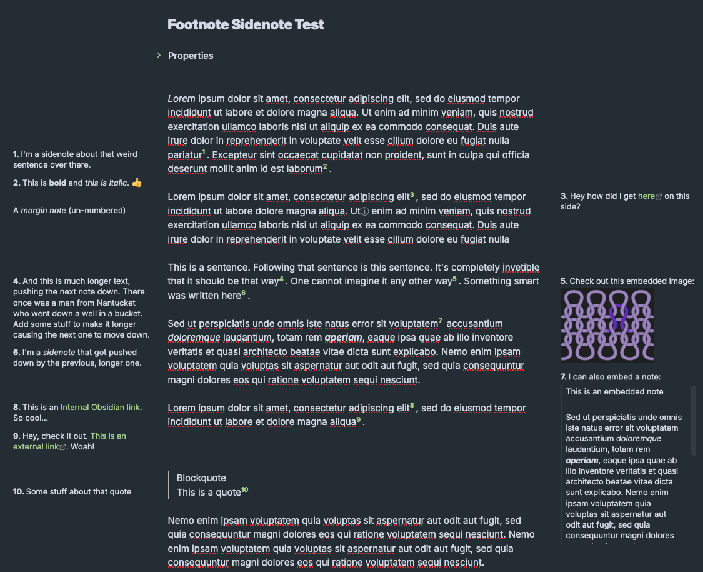
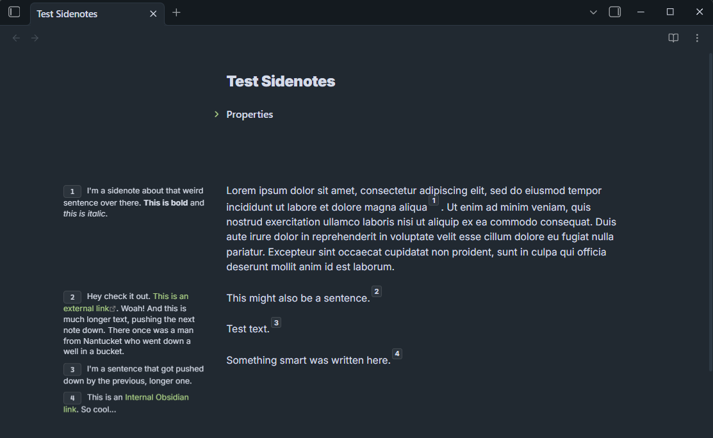

# Side-Notes

I first discovered sidenotes, at least in a conscious way, on [Gwern.net](https://gwern.net/sidenote) which was referencing [Edward Tufte's conventions](https://edwardtufte.github.io/tufte-css/).


_Basic sidenote capabilities demonstrated_


_An optional style that highlights references._


_Editing a sidenote in the margin, adding a new sidenote, then adding a new margin note_

## Download

- Download: [Side-Notes from Community Plugins](https://community.obsidian.md/plugins/side-notes)

## Features

### Sidenotes

Numbered notes displayed in the margin instead of at the bottom of the note. Run the `Insert sidenote` command to start one.

- **Two formats**, chosen in settings:
  - **HTML spans**: `<span class="sidenote">text</span>` — I use these because it was simple to make them work in my web-published notes too.
  - **Markdown footnotes**: `This is a sentence[^1].`
- **Visible in Editing and Reading modes.** Source mode is left alone: it shows the bare markdown.
- **Editable in the margin.** In Editing mode, click a sidenote, edit it, and press `ENTER` to save; `SHIFT+ENTER` adds a new line (HTML format only — Markdown footnote definitions are single-line). Reading mode is read-only.
- **Supports Obsidian Markdown formatting**, like `**bold**`, `_italic_`, `inline code`, `[[Internal link]]`, `[External link](https://example.com)`, `![[Embedded image.png|200]]`, and `![[Embedded note]]`.
- **Per-note margin override.** Pin an individual sidenote to the margin opposite the global "Sidenote position" setting with the `Insert sidenote (opposite margin)` command, or by hand:
  - **HTML**: add a `right` or `left` class, e.g. `<span class="sidenote right">text</span>`
  - **Footnotes**: append `-r` or `-l` to the footnote ID, e.g. `[^3-r]`

### Margin notes

Un-numbered notes in the margin, for asides that don't need a reference number. In Editing mode a small marker shows where the note is anchored; it can also be configured to open as a popup instead. Click to edit.

- **Markdown footnotes**: `[^mn-1]` or `[^mn-kitchen]`
- **HTML**: `<span class="sidenote margin-note">`
- **Per-note margin override**, same as sidenotes: use the `Insert margin note (opposite margin)` command, or add a `right`/`left` class (HTML) or `-r`/`-l` suffix (footnotes, composes with the `mn-` prefix, e.g. `[^mn-2-l]`).

### Numbering

- Superscript reference numbers are added to the text and increment automatically.
- Displayed as Arabic numerals, Roman numerals, letters, or hidden entirely.
- Styled plain or as badges (including a neumorphic style) to make references easier to spot.
- Optionally restart numbering at each heading.

### Responsive layout

- Sidenotes sit in the left or right margin, anchored to the referencing line.
- Font size shrinks as horizontal space gets tighter; below configurable breakpoints the margin switches to a compact layout and then hides entirely.
- Collision avoidance keeps notes from overlapping when several land close together.
- Width, gaps, and page offset are all adjustable, as are font size, line height, text alignment, and colors.

### PDF export

Works with both HTML sidenotes and footnotes (experimental). Notes are laid out in the margin rather than inline, and margin notes are dropped from the endnote list at the end of the document.

### Citations

Pandoc citations inside a sidenote are shown as short, readable author–year citations.

| You write                         | Shown as                            |
| --------------------------------- | ----------------------------------- |
| `[@zhuqianzhi_dao_2000, 6.25–26]` | Zhu Qianzhi 2000, 6.25–26           |
| `[@a; @b]`                        | Smith 1999; Lee et al. 2004         |
| `[see @a, pp. 3-5]`               | see Smith 1999, pp. 3–5             |
| `[-@a]`                           | 1999                                |
| `@a` or `@a [p. 33]`              | Smith (1999) or Smith (1999, p. 33) |
| `@{key with 'odd' chars}`         | braced keys work in every form      |

- **Setup:** Provide the bibliography (BibTeX `.bib` or CSL JSON `.json`) under **Settings → Side-Notes → Citations**, as a path in your vault. A note can override it with a `bibliography` property (text or list; vault-relative or relative to the note).
- Hover a citation to see the full reference. A key with no entry in the bibliography stays as typed, with a dotted underline.
- Citations are only rendered inside sidenotes and margin notes, not in the main text. Without a bibliography file nothing changes.
- Formatting is deliberately simple (author–year plus locator). Pandoc still does the real formatting on export.

## Maybe Features

Suggestions that have not been implemented and are not yet being actively developed.

- [ ] Badge style for margin notes
- [ ] Option for style templates for multiple sidenotes types - e.g. one type has a background color, another does not. This seems more easily implemented if using HTML sidenotes.
- [ ] Highlight the referencing _sentence_ in the main note text when hovering over a sidenote
- [ ] Command: Switch between Footnotes visible <-> Sidenotes visible

## Setup

1. If copying manually from this repo, download the plugin from [the Releases page](https://github.com/cparsell/sidenotes/releases).
2. Add the plugin files to your Obsidian vault.
   Copy the contents into `YOUR-VAULT/.obsidian/plugins/sidenotes`.
3. If copying manually, restart Obsidian and then enable the plugin in **Settings**.
4. **Configure the settings** how you like:
   - Choose **sidenote format**:
     - **Footnotes**: Traditional Markdown footnotes will become sidenotes
       - **Hide footnotes:** Choose if you want to hide the origina footnotes at the bottom of the note
       - **Hide footnote numbers:** Hide the original Markdown reference numbers in the note text - e.g. this: `[1]`
     - **HTML**: uses `<span>` elements to format the sidenotes. I originally designed using this because it was an easy way for me to set up CSS styles in Obsidian as well as CSS styles in my web-published notes
   - **Number style**: Try 'neumorphic badge' for numbers that are more visually identifiable
   - **Width & Spacing**:
     - **Minimum sidenote width**
     - **Maximum sidenote width**
     - **Sidenote anchor**: Which gap below is a fixed position, and which is just a minimum the sidenote's width gives way to protect
       - **Anchor to text**: the sidenote stays a fixed distance from the text (**Minimum gap between sidenote and text**), so it moves whenever the text does — including with **Page offset factor** below
       - **Anchor to editor edge**: the sidenote stays a fixed distance from the pane's edge (**Minimum gap between sidenote and editor edge**), full stop. If that and the minimum text gap can't both fit, the sidenote's _width_ shrinks instead of its position moving — down to the minimum sidenote width, below which it hides
     - **Minimum gap between sidenote and text**
     - **Minimum gap between sidenote and editor edge**
     - **Gap drift factor**: How much the text gap grows as the pane gets wider. Anchored to text, this moves the sidenote further out; anchored to the edge, position never moves — it only tightens how much the sidenote's width can use
   - **Page offset factor**: How much the note text is shifted over to make room for sidenotes (only affects notes that have sidenotes). Only moves the text — never the sidenotes themselves

## Use

Run the command `Insert Sidenote`.

### **If using HTML**

It will insert this:

```html
<span class="sidenote">{cursor}</span>
```

Click on the sidenote to edit it in the margin. Press `ENTER` to update. Press `SHIFT+ENTER` to add a new line in the sidenote.

### **If using footnotes**

it will insert `[^1]` and add a footnote at the bottom of the document. Press `ENTER` to update. Using `SHIFT+ENTER` will not work to add a new line in a footnote because of how footnotes are formatted in Markdown.

### Opposite margin

By default, every sidenote and margin note lands in whichever margin the **Sidenote position** setting points to. To pin a single note to the other margin instead, run `Insert sidenote (opposite margin)` or `Insert margin note (opposite margin)` from the command palette. These insert the same markup as the regular commands, plus a side marker:

- **HTML**: a `right` or `left` class is added, e.g. `<span class="sidenote right">{cursor}</span>`
- **Footnotes**: a `-r` or `-l` suffix is added to the footnote ID, e.g. `[^3-r]` (composes with margin notes: `[^mn-2-l]`)

### Web Publishing

I use [Digital Garden](https://github.com/oleeskild/Obsidian-Digital-Garden) to publish a subset of my notes to a website. In the framework Digital Garden has set up, a CSS file called `custom-styles.css` is where one adds any CSS to modify the default styles.

The snippet of CSS I've been using for web publishing is located in `/digital-garden/custom-styles.css`.

## Known issues

- [ ] Feature "Restart numbering after each heading" does not work currently.
- [ ] Changing style settings causes Editing mode sidenotes to disappear until restart

### Removed

- **Editing sidenotes in Reading mode** (the "Allow sidenote edits in reading mode" setting) has been removed. Reading mode has no editor behind it, so edits had to be written straight to the file and then raced Obsidian's re-render of the preview — which caused edits to silently not save, sidenotes to disappear after editing, and numbering to go wrong. Sidenotes are still fully rendered in Reading mode; editing now happens in Editing mode only. If you had the setting enabled, it is simply ignored.

## Alternatives and inspirations

- [FelixHT's Obsidian Sidenotes Plugin](https://github.com/FelixHT/obsidian_side_notes) - hasn't been updated in a while - one user reported it doesn't fully function any longer but I haven't tested it. I did build some of the functionality in my plugin based on this.
- [SideNote Plugin](https://github.com/mofukuru/SideNote) allows you to add comments to a piece of text, and this is viewable in the side panel.
- [Cornell Notes Learning Vault](https://github.com/TfTHacker/cornell-notes-learning-vault) from TfTHacker
- [crnkv/obsidian-sidenote-auto-adjust-module](https://github.com/crnkv/obsidian-sidenote-auto-adjust-module) ([forum post](https://forum.obsidian.md/t/css-snippet-sidenote-auto-adjust-module-four-styles-available/94495))
- [Collapsible Sidenotes using a CSS trick](https://forum.obsidian.md/t/meta-post-common-css-hacks/1978/341)
- [Sidenotes Using CSS also](https://scripter.co/sidenotes-using-only-css/)
- [A sidenote solution similar to Tufte CSS](https://www.kooslooijesteijn.net/blog/sidenotes-without-js)
- [Obsidian-sidenote-callout](https://github.com/xhuajin/obsidian-sidenote-callout/blob/main/README.md) - I did not use a custom callout like this because I wanted the sidenotes to also be publishable.
- [Tufte style sidenotes](https://medium.com/obsidian-observer/tufte-style-sidenotes-in-obsidian-89b0a785bc54)
- [Collapsible inline notes and sidenotes](https://forum.obsidian.md/t/collapsible-inline-notes-and-sidenotes/31909)

## Support

<a href="https://buymeacoffee.com/netsurgem"></a>
